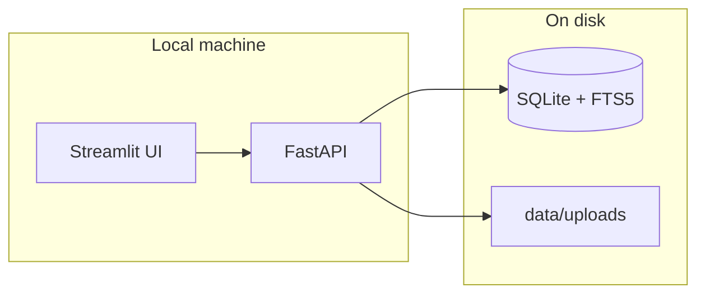
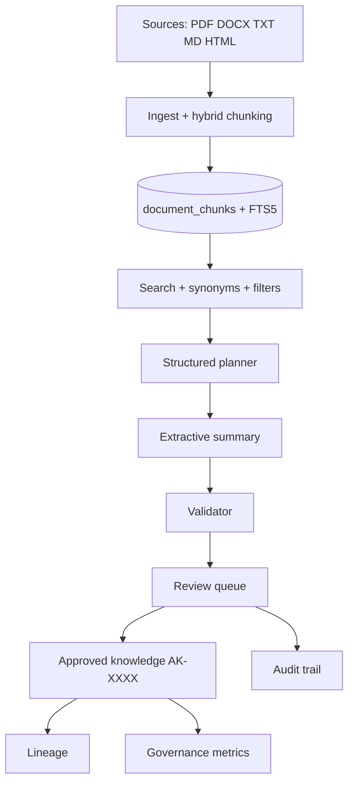

# Architecture (v1.0)

Local-first knowledge governance: **Streamlit → FastAPI → SQLite/FTS5** on `127.0.0.1`.

- Study: [STUDY_GUIDE.md](STUDY_GUIDE.md)
- APIs: [API_REFERENCE.md](API_REFERENCE.md)

---

## System context



---

## Knowledge lifecycle



---

## Layer responsibilities

- **Ingestion** — `BaseParser` plugins, hybrid chunker, content fingerprint
- **Repository** — `documents`, `document_chunks`, lifecycle fields
- **Search** — FTS5, `config/synonyms.json`, filters, explainable ranking
- **Agents** — Planner → Search → Summary → Validator (no LLM)
- **Governance** — `review_items`, `review_sources`, `review_actions`, `approved_knowledge`
- **Observability** — Search history, health, governance metrics, lineage API

---

## Main database tables

- `documents` — Metadata, tags, status, version, relationships
- `document_chunks` — Text units (page, chunk_index)
- `chunks_fts` — FTS5 virtual table
- `search_history`, `search_clicks` — Search analytics
- `ingestion_jobs` — Folder ingest status
- `review_items` — Ask/review state
- `review_sources` — Citations per review
- `review_actions` — Audit log
- `approved_knowledge` — Promoted answers

---

## Repository layout

```text
backend/app/
  agents/          Planner, search, summary, validator, pipeline
  api/routes/      HTTP handlers
  ingestion/       Parsers + chunker
  services/        Business logic
  db/              Schema + migrations
frontend/          Streamlit pages + API client
config/synonyms.json
```

---

## Version policy

- **v1.0** — Feature freeze
- **v1.1** — UI polish only
- **v2.0** — Optional embeddings / local LLM (IT approval)

Office rules: [OFFICE_SAFETY.md](OFFICE_SAFETY.md)
